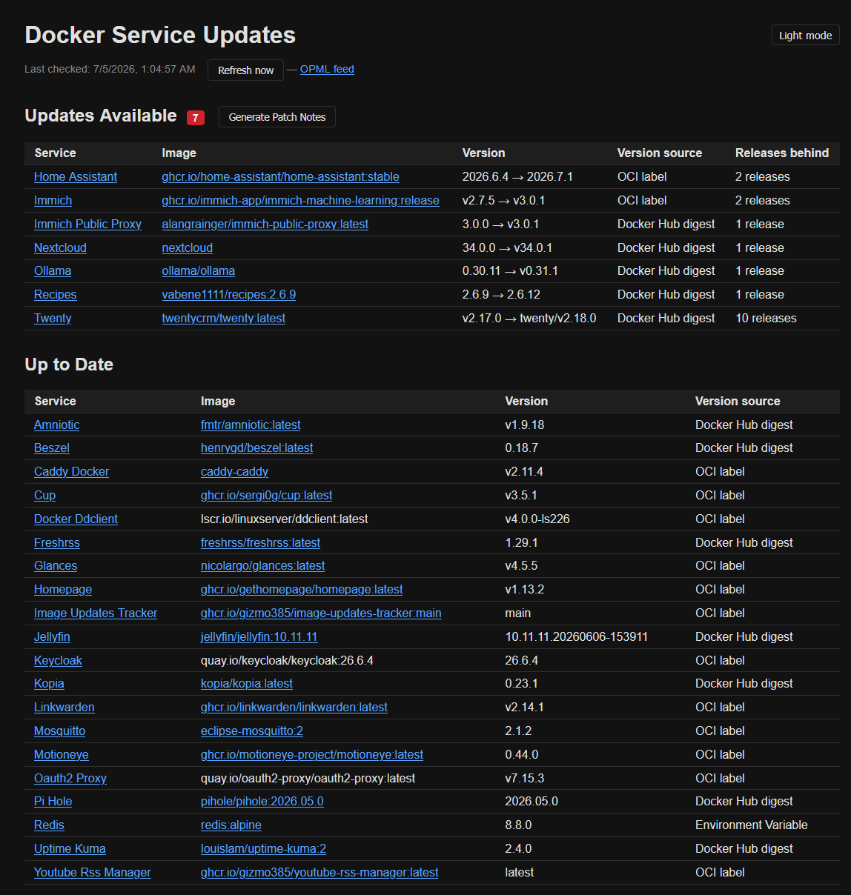
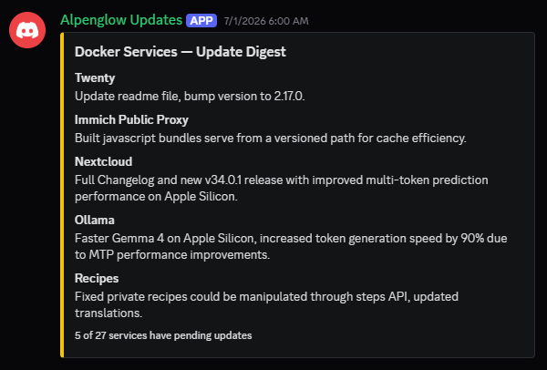

# Images Updates Tracker

Tracks running Docker containers and checks for newer releases on GitHub. Provides a web dashboard, an OPML list of per-service release feeds (with nightly/beta/RC builds filtered out), and an optional Discord bot that generates summaries of pending updates.



The Discord bot update messages look like:



## Configuration

### overrides.yaml

Mount your own config at `/config/overrides.yaml` (or set `OVERRIDES_PATH` to another path).

```yaml
# Map image names to GitHub owner/repo when automatic detection fails
overrides:
  postgres: postgres/postgres
  redis: redis/redis

# Human-friendly display names for repos
names:
  postgres/postgres: PostgreSQL
  redis/redis: Redis
```

#### Excluding pre-releases

Releases GitHub flags as pre-releases are always hidden from the dashboard and feeds. Releases are also hidden when their tag contains an excluded word, matched against each part of the tag split on punctuation (so `rc` matches `v1.2.0-rc2` and `v1.2.0rc1`, but not `v1.0-arch`).

```yaml
exclude_releases:
  # Words excluded for every service. Omit to use the built-in list
  # (alpha, beta, rc, pre, preview, nightly, canary, dev, snapshot, edge, unstable),
  # or set to [] to rely only on GitHub's pre-release flag.
  global: [alpha, beta, rc, nightly]
  # Extra words excluded for specific repos only
  repos:
    kopia/kopia: [test]
```

The feeds in `/feeds.opml` are served from `/feeds/<owner>/<repo>.atom` and cached for 15 minutes.

### Environment variables

Copy `.env.example` to `.env` and fill in the values:

```sh
cp .env.example .env
```

| Variable | Default | Description |
|---|---|---|
| `OVERRIDES_PATH` | `/config/overrides.yaml` | Path to the overrides config file |
| `GITHUB_TOKEN` | _(none)_ | GitHub personal access token (recommended to avoid rate limits) |
| `DISCORD_TOKEN` | _(required for bot)_ | Discord bot token |
| `OLLAMA_HOST` | `http://localhost:11434` | Ollama API base URL |
| `OLLAMA_MODEL` | `qwen2.5:1.5b` | Ollama model to use for digest summaries |
| `DIGEST_CRON` | `0 9 * * *` | When to send summaries via the Discord bot |
| `DIGEST_CHANNEL_ID` | _(none)_ | Channel for the scheduled digest; without it only `/digest` works |


## Annotations in the Discord digest (optional)

Digest messages use Discord's Components v2 layouts: a coloured container
with a link button beside each service.

If the bot has `ANNOTATIONS_URL`, its digest starts with the updates that URL
annotates, grouped, each with a short note and a link. Services it doesn't
cover get the Ollama summary in a second message. Without it, or if it can't
be reached, the bot sends the Ollama digest alone.

The tracker doesn't care what produces the annotations. For example,
[alpenglow's upgrades board](https://github.com/gizmo385/alpenglow/tree/main/upgrades-board)
files a Vikunja card for each pending update, has Claude assess it, and serves
the verdicts this way. The URL must return JSON like:

```json
{
  "title": "Upgrades",
  "link_label": "Open card",
  "groups": [{"name": "Easy", "emoji": "🟢"}, {"name": "Hold", "emoji": "🔴"}],
  "items": [
    {"repo": "Freika/dawarich", "title": "Dawarich 1.20.0 → 1.20.1",
     "group": "Easy", "note": "Bug-fix patch.", "url": "https://board.example.com/tasks/9"}
  ]
}
```

`repo` is the GitHub `owner/name` the tracker follows for that service.
`groups` sets the display order, and only `repo` is required on an item.
Other fields are ignored, so a service can serve the same JSON to other
consumers. `GET /api/updates` on the web server gives you the tracker's side
to build annotations from.

## Running with Docker Compose

```yaml
services:
  image-tracker:
    image: ghcr.io/gizmo385/image-updates-tracker:main
    ports:
      - "8585:8585"
    volumes:
      - ./overrides.yaml:/config/overrides.yaml:ro
      - /var/run/docker.sock:/var/run/docker.sock:ro
    env_file: .env

  image-tracker-bot:
    image: ghcr.io/gizmo385/image-updates-tracker-bot:main
    volumes:
      - ./overrides.yaml:/config/overrides.yaml:ro
      - /var/run/docker.sock:/var/run/docker.sock:ro
    env_file: .env
```

Both containers need read access to the Docker socket to inspect running containers.
