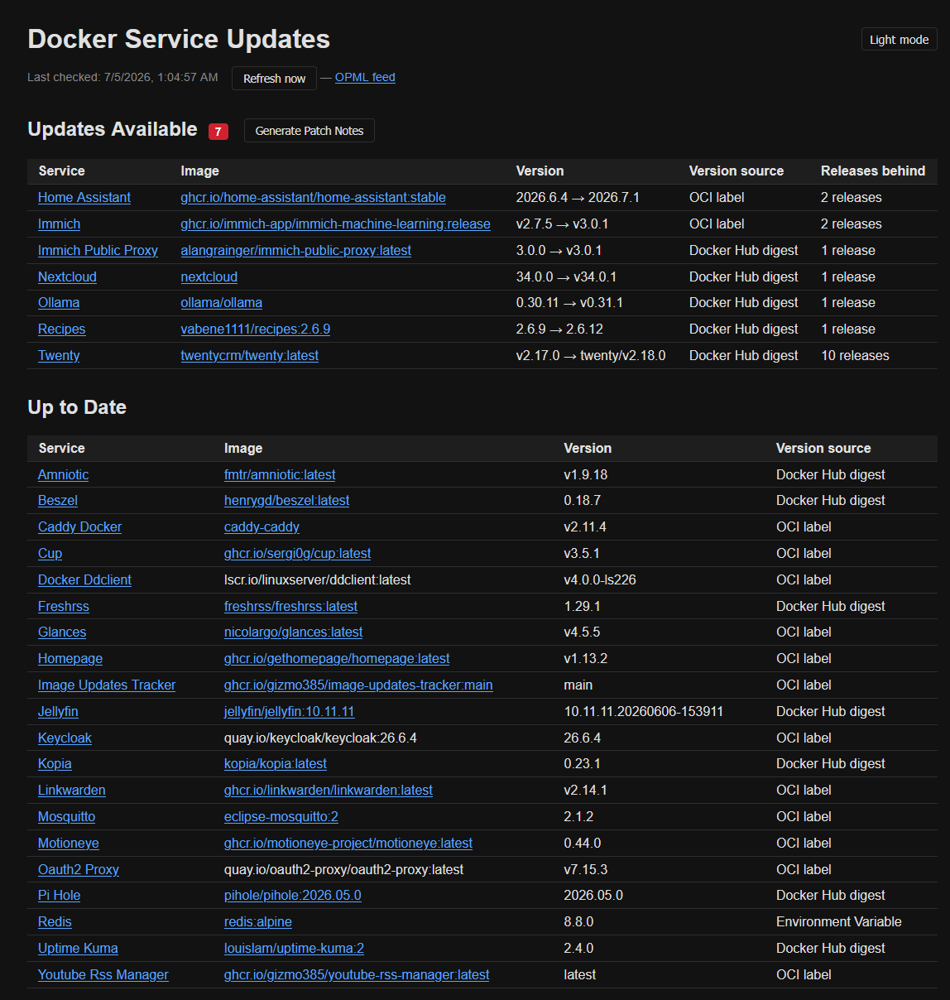

# Images Updates Tracker

Tracks running Docker containers and checks for newer releases on GitHub. Provides a web dashboard, an OPML list of per-service release feeds (with nightly/beta/RC builds filtered out), and a JSON API for other tools to build on. The web page can ask Ollama to summarise the pending release notes.



## Configuration

### overrides.yaml

Mount your own config at `/config/overrides.yaml` (or set `OVERRIDES_PATH` to another path).

```yaml
# Map image names to GitHub owner/repo when automatic detection fails
overrides:
  postgres: postgres/postgres
  redis: redis/redis

# Human-friendly display names for repos
names:
  postgres/postgres: PostgreSQL
  redis/redis: Redis
```

#### Excluding pre-releases

Releases GitHub flags as pre-releases are always hidden from the dashboard and feeds. Releases are also hidden when their tag contains an excluded word, matched against each part of the tag split on punctuation (so `rc` matches `v1.2.0-rc2` and `v1.2.0rc1`, but not `v1.0-arch`).

```yaml
exclude_releases:
  # Words excluded for every service. Omit to use the built-in list
  # (alpha, beta, rc, pre, preview, nightly, canary, dev, snapshot, edge, unstable),
  # or set to [] to rely only on GitHub's pre-release flag.
  global: [alpha, beta, rc, nightly]
  # Extra words excluded for specific repos only
  repos:
    kopia/kopia: [test]
```

The feeds in `/feeds.opml` are served from `/feeds/<owner>/<repo>.atom` and cached for 15 minutes.

### Environment variables

Copy `.env.example` to `.env` and fill in the values:

```sh
cp .env.example .env
```

| Variable | Default | Description |
|---|---|---|
| `OVERRIDES_PATH` | `/config/overrides.yaml` | Path to the overrides config file |
| `GITHUB_TOKEN` | _(none)_ | GitHub personal access token (recommended to avoid rate limits) |
| `OLLAMA_HOST` | `http://localhost:11434` | Ollama API base URL |
| `OLLAMA_MODEL` | `qwen2.5:1.5b` | Ollama model for the page's "Generate Patch Notes" summaries |


## Updates are offered once the image exists

A GitHub release often appears before its image does (Docker official images
can lag by days), and release names don't always match image tags (ClickHouse
releases `v26.10.10.3-stable`, tagged `26.10.10.3`). For each service with
newer releases the tracker works out the tags the release would have from the
tag the running image uses (its `v`, a variant such as `-alpine`, a shortened
version) and asks the registry whether one exists.

The newest release with an image is the update. Newer ones are shown as
"released, image not published yet" on the page and in the CLI, and don't
count as an update. In `GET /api/updates` each service has:

- `latest_tag`: the image tag found for `latest_version`
- `waiting`: releases with no image yet
- `image_verified`: `false` when the check couldn't decide and the releases
  are offered unchecked: the registry didn't answer, the running tag has no
  version in it (`sha-1a2b3c`), or nothing was found for a release more than
  a week old, which means the tag guess is wrong rather than the image late

## Running with Docker Compose

```yaml
services:
  image-tracker:
    image: ghcr.io/gizmo385/image-updates-tracker:main
    ports:
      - "8585:8585"
    volumes:
      - ./overrides.yaml:/config/overrides.yaml:ro
      - /var/run/docker.sock:/var/run/docker.sock:ro
    env_file: .env
```

The container needs read access to the Docker socket to inspect running containers.

## Notifications

The tracker reports what exists upstream and doesn't send messages itself.
`GET /api/updates` has everything a notifier needs: each service's current and
latest version, the image tag to pull, its newer releases, and releases still
waiting on an image. (It used to ship a Discord bot; that was removed in favour
of whatever consumes the API deciding what to say.)
